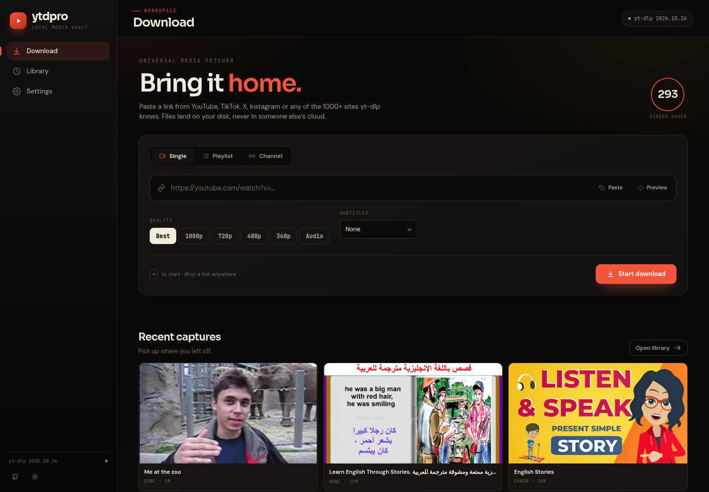
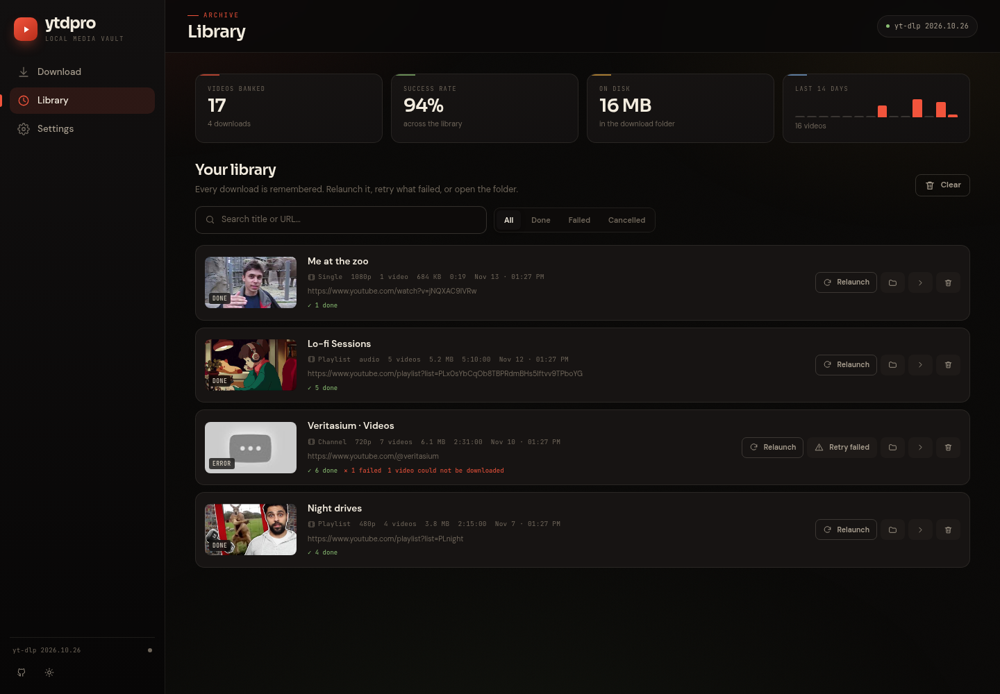
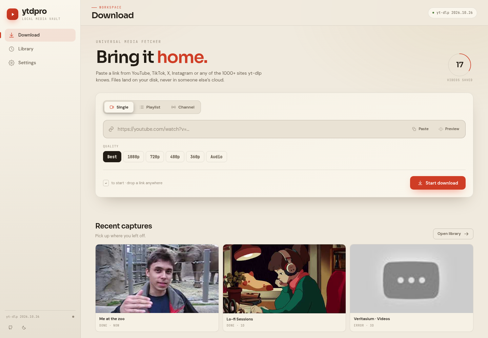
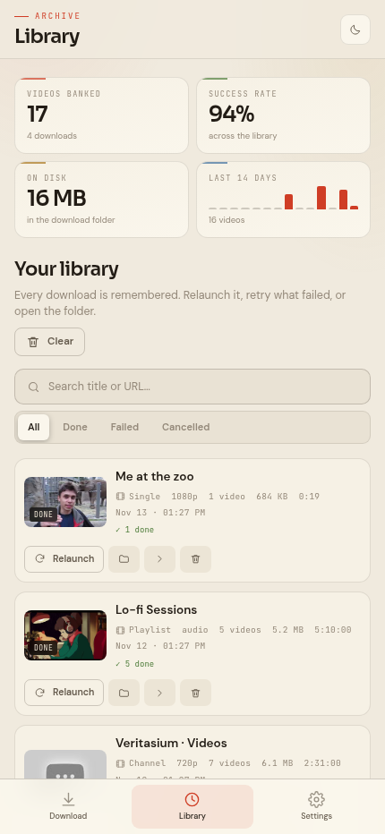

<div align="center">



<br><br>

# ytdpro

**A private, local web UI for [yt-dlp](https://github.com/yt-dlp/yt-dlp).**
Paste a link. Keep the file. No account, no cloud, no nonsense.

[](https://github.com/ethicalvulnlab/ytdpro/actions/workflows/ci.yml)


[Features](#features) · [Install](#install) · [Screenshots](#screenshots) · [How it works](#how-it-works) · [Troubleshooting](#troubleshooting)

</div>

---

## Why ytdpro

Most downloaders want an account, a subscription, or your files on their server.
ytdpro is a small Flask app that runs **on your machine**, drives yt-dlp, and saves
everything to a folder you choose. The browser is just the remote control.

- **Local by design** — binds to `127.0.0.1` by default, no telemetry, no accounts.
- **Actually remembers** — a real download library with titles, thumbnails, file
  sizes, search and one-click **relaunch**.
- **Pleasant to use** — live progress over SSE, drag-and-drop links, dark/light
  themes, English / French / Arabic (RTL), and a layout that works on a phone.

## Features

### Downloading

- **Single video**, **playlist**, or **whole channel** (Videos / Shorts / Streams / Everything)
- Quality presets: **Best, 1080p, 720p, 480p, 360p**, or **audio-only MP3**
- **Date range** filters for channels
- **Skip already-downloaded** items with a per-channel archive
- **URL preview** — title, channel, duration, thumbnail before you commit
- **Cancellation** for a whole job or a single video
- **Retry** one failed video without restarting the job
- **Cookies from your browser** for private / age-restricted videos
- **Subtitles per download** — pick a language, several codes, or all; written as `.vtt` next to the video
- **SponsorBlock** segment removal
- Adaptive concurrency, speed limit, socket timeout, polite request delays
- Disk-space check and clear, human-readable errors

### Library

- Persistent **SQLite history** — survives restarts and browser refreshes
- Rich cards: thumbnail, title, source URL, mode, quality, duration, total size
- **Search** by title or URL, filter by **Done / Failed / Cancelled**
- **Relaunch** any past download with its original mode, quality and dates (a new attempt gets its own entry)
- **Retry failed** items from a finished job — results are merged back into the same library entry, so no duplicate cards
- **Open folder** / **open file** straight from the library
- **Stats**: videos banked, success rate, disk usage, 14-day activity
- Configurable retention (30 days, 90 days, 1 year, or forever)
- Per-item detail view with every file and its status

### Experience

- Live progress via **Server-Sent Events**, with polling fallback
- Video-card grid with per-item status, speed, ETA and progress
- **Recent captures** strip on the download page
- Drag a link anywhere, press <kbd>Enter</kbd> to start, <kbd>/</kbd> to search
- Responsive: desktop rail, tablet icon rail, mobile bottom navigation
- Accessible focus rings and `prefers-reduced-motion` support
- **SSRF protection** — links resolving to private/internal addresses are refused

## Screenshots

| Library | Light theme |
| --- | --- |
|  |  |

<p align="center">
  
</p>

## Install

### One command (Linux & macOS)

```bash
curl -sSL https://raw.githubusercontent.com/ethicalvulnlab/ytdpro/main/install.sh | bash
```

This installs into `~/.ytdpro`, creates a virtualenv, adds a `ytdpro` launcher to
`~/.local/bin`, and starts the app at <http://localhost:8080>.

> Requires `python3`, `python3-venv` and `ffmpeg`. The installer offers to install
> ffmpeg with `apt` or `brew` when it is missing.

### Manual

```bash
git clone https://github.com/ethicalvulnlab/ytdpro.git
cd ytdpro

python3 -m venv venv
./venv/bin/pip install -r requirements.txt

# Linux:  sudo apt install ffmpeg
# macOS:  brew install ffmpeg
# Windows: https://ffmpeg.org/download.html (add to PATH)

./venv/bin/python server.py
```

Open <http://localhost:8080>.

### Windows

```cmd
py -m venv venv
venv\Scripts\pip install -r requirements.txt
venv\Scripts\python server.py
```

### Docker

```bash
docker compose up -d --build
```

- <http://localhost:8080>
- `./downloads` → files
- named volume `ytdpro-data` → settings and library database

Or without compose:

```bash
docker build -t ytdpro .
docker run -d --name ytdpro -p 8080:8080 \
  -v "$PWD/downloads:/downloads" ytdpro
```

## Using it

1. Paste a URL (or drag it from another tab).
2. Pick **Single**, **Playlist** or **Channel**.
3. Choose a quality preset — or **Audio** for an MP3.
4. For channels, pick a section and optional publish dates.
5. Optionally choose **Subtitles** — a common language, *All languages*, or
   **Custom…** with codes like `en,fr,ar`. The preview shows what the video
   actually offers.
6. Hit **Start download**.

Playlists and channels are scanned first: you see how many videos were found,
then confirm before anything downloads. Single videos start immediately.

When the job finishes it appears in the **Library**, where you can relaunch it,
retry failures, open the folder, or delete the record.

### Keyboard shortcuts

| Key | Action |
| --- | --- |
| <kbd>Enter</kbd> | Start the download from the URL field |
| <kbd>/</kbd> | Focus library search |
| <kbd>Esc</kbd> | Close a dialog |

## Where files go

```
~/Downloads/ytdpro/
├── Videos/
├── Playlists/
│   └── Playlist Name/
└── Channels/
    └── Channel Name/
        ├── Videos/
        ├── Shorts/
        ├── Streams/
        └── .archives/          # skip-already-downloaded lists
```

Change the folder in **Settings → Storage**, or with `YT_DOWNLOAD_DIR`.

## Put videos on a TV / USB drive

TV receivers usually fail on YouTube's VP9/AV1/Opus codecs, not on the MP4
container. Convert them to **H.264 + AAC** and turn `.vtt` subtitles into `.srt`.

```bash
# convert a whole playlist folder into ./TV/
./convert-for-tv.sh ~/Downloads/ytdpro/Playlists/"English Stories"

# 720p + Arabic default subtitle
./convert-for-tv.sh ~/Videos -o TV --max-height 720 --default-lang ar
```

Full guide, manual ffmpeg commands, USB/FAT32 rules and troubleshooting:
**[TV-CONVERSION.md](TV-CONVERSION.md)**.

## Configuration

Environment variables:

| Variable | Default | Purpose |
| --- | --- | --- |
| `YT_PORT` | `8080` | HTTP port |
| `YT_HOST` | `127.0.0.1` | Bind address. Keep it local unless you add auth |
| `YT_DOWNLOAD_DIR` | `~/Downloads/ytdpro` | Where media is written |
| `YT_SETTINGS_FILE` | `~/.ytdpro_settings.json` | Settings file |
| `YT_JOBS_DB` | next to the settings file | SQLite library database |

Everything else is editable in the UI: concurrency, default quality, socket
timeout, speed limit, request delays, cookies browser, subtitles, SponsorBlock,
retention and language.

## Privacy & security

- The UI has **no authentication**. By default it listens on `localhost` only.
  If you set `YT_HOST=0.0.0.0`, anyone who can reach the port can use it.
- ytdpro refuses URLs whose hostname resolves to a non-public IP address
  (loopback, private ranges, link-local, `.local`, `.internal`, …) to prevent
  server-side request forgery.
- The file-open endpoints only accept paths **inside the configured download
  folder**.
- No analytics, no accounts, no third-party storage. Outbound traffic is limited
  to the sites you ask yt-dlp to fetch, PyPI (version check), and the optional
  EJS remote component.
- Respect the terms of service of the sites you use and the rights of the
  creators whose work you download.

## Development

```
ytdpro/
├── server.py              # Flask app, job runner, SQLite library
├── templates/index.html   # single-file UI (no build step)
├── tests/test_server.py   # pytest suite
├── install.sh
├── Dockerfile
└── docker-compose.yml
```

Run the tests:

```bash
python3 -m venv venv
./venv/bin/pip install -r requirements.txt -r requirements-dev.txt
./venv/bin/python -m pytest tests/ -q
```

The test suite covers URL validation, settings, progress math, SQLite
persistence, history search/detail/delete, stats, relaunch, retry-failed and
path-traversal protection. No network access is required for tests.

## Troubleshooting

**“yt-dlp is behind the latest version”**
YouTube changes often. Update and restart:

```bash
./venv/bin/pip install -U yt-dlp     # or: pipx upgrade yt-dlp
```

**“Sign in to confirm you're not a bot” / age-restricted video**
Open **Settings → Access → Browser cookies** and pick the browser you are logged
in with. Close that browser first — Chromium locks its cookie database.

**MP3 conversion fails**
Install `ffmpeg` and make sure `ffprobe` is on the same PATH.

**Port already in use**

```bash
YT_PORT=8081 ./venv/bin/python server.py
```

**Every video fails with `HTTP Error 403`**
YouTube changed something or your yt-dlp is stale. Update it **inside the app's
venv** and restart — do not use system `pip` on Kali/Debian:

```bash
cd ~/Downloads/ytdpro-web
./venv/bin/pip install -U yt-dlp
pkill -f "ytdpro-web.*server.py"
./venv/bin/python server.py
```

If it still fails, set **Settings → Access → Browser cookies** to the browser you
use for YouTube, close that browser, and retry.

**Downloads are slow / rate limited**
Lower **Settings → Downloads → Concurrent downloads**, or set a **speed limit**
in the Network panel.

## License

[MIT](LICENSE) © 2026 ethicalvulnlab

ytdpro is an independent project and is not affiliated with YouTube, Google, or
any other platform. It is a front-end for [yt-dlp](https://github.com/yt-dlp/yt-dlp),
which is released under the Unlicense.
